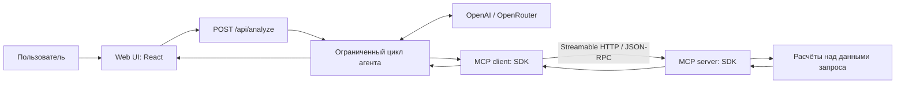

# Run Notes — ассистент анализа ML-экспериментов

Личный проект Гулямова Рахима. Помогает ML-инженеру разобрать серию запусков:
сравнить качество и время, проверить историю обучения и сформулировать следующий
эксперимент. Ответ опирается на MCP-инструменты; численные результаты можно раскрыть
и сверить непосредственно в интерфейсе.

**[Открыть сервис](https://run-notes-rahim.resourcefulbottle4.chatgpt.site)** ·
**[Презентация](https://run-notes-rahim.resourcefulbottle4.chatgpt.site/presentation)** ·
[Самостоятельный HTML-файл](public/presentation.html) · [Подробный план](docs/plan.md)

Для свободных вопросов нужен собственный API-ключ OpenAI или OpenRouter.
Без ключа работает расчётный обзор через настоящий MCP; это отдельный режим без LLM.
Реальный запрос к платной модели пока не проверен: ключа на момент разработки нет.
Точный статус проверок и поставки — в [docs/verification.md](docs/verification.md).

## Основной сценарий

1. Открыть учебный пример или импортировать JSON/CSV своих экспериментов.
2. Выбрать группу, запуски, метрику и направление. Например, accuracy ↑ или val_loss ↓.
3. В настройках подключить ключ и модель с tool calling.
4. Спросить: «Какой запуск лучше и какой следующий эксперимент стоит провести?»
5. Раскрыть вызовы MCP, проверить числа и ограничения вывода. Скачать Markdown-отчёт.

Внутри запроса модель сама выбирает инструменты. Вопрос о переобучении приводит
к запросу истории/диагностики, сравнение — к ранжированию. Модель не получает shell,
не запускает обучение и не имеет права изменять данные.

## Архитектура



TypeScript, React 19, Vinext/Vite, официальный MCP TypeScript SDK, Zod, Papa Parse.
Сервер собирается в Cloudflare Worker. Данные и ключ находятся в памяти вкладки;
на сервер передаются на время запроса и не записываются в БД. История чата между
отдельными вопросами не сохраняется: каждый вопрос анализируется заново.

Внутренний клиент использует настоящий `StreamableHTTPClientTransport`:
`initialize → notifications/initialized → tools/list → tools/call`.
Его fetch-адаптер передаёт HTTP Request в тот же обработчик сервера внутри текущего
запроса, без внешнего сетевого перехода. Так загруженные данные изолированы и
не требуется временное глобальное хранилище или публичная сессия. Это осознанный
компромисс MVP, а не отдельный сетевой микросервис.

Публичный `/mcp` использует тот же обработчик с учебным набором. Внешний MCP-клиент
не видит загрузок пользователей. Транспорт stateless, JSON responses, без SSE-сессий.

| Инструмент | Аргументы | Результат |
| --- | --- | --- |
| `list_runs` | — | ID, группы, метрики, параметры, число точек истории |
| `compare_runs` | `run_ids`, `metric`, `direction` | Рейтинг, baseline, разницы, совпавшие лучшие значения, исключения |
| `inspect_run` | `run_id` | Полный запуск и история loss |
| `diagnose_run` | `run_id` | Эвристика переобучения и исходные числа |

## Запуск локально

Нужны Node.js 22.13+ и npm. Python не нужен для веб-сервиса.

```sh
git clone https://github.com/RahimGulyamov/ml-experiment-assistant.git
cd ml-experiment-assistant
npm ci
npm run dev
```

Открыть адрес Local из терминала (обычно `http://127.0.0.1:5173`). Для LLM указать
ключ в форме приложения. Значение по умолчанию — `gpt-4.1-mini` для OpenAI или
`openai/gpt-4.1-mini` для OpenRouter; доступ и стоимость определяются провайдером.
Поддерживаются OpenAI-compatible **Chat Completions** и модели с function/tool calling.
Произвольные URL провайдеров не принимаются. Ollama в этом MVP не подключена.

```sh
npm run check       # строгий TypeScript и тесты
npm run build       # самостоятельный HTML и production bundle
npm start           # локально запустить production Worker
npm run mcp:smoke -- http://127.0.0.1:5173/mcp
```

Пример подключения внешнего MCP-клиента:

```json
{
  "mcpServers": {
    "run-notes": {
      "url": "https://run-notes-rahim.resourcefulbottle4.chatgpt.site/mcp"
    }
  }
}
```

Формат конфигурации зависит от клиента; транспорт — Streamable HTTP.
Доступ внешнего клиента к приватной публикации ограничивается хостингом.

## Формат данных

JSON — массив объектов. Полный пример: [experiments.json](public/examples/experiments.json).

```json
[
  {
    "id": "run-001",
    "name": "Baseline",
    "experiment": "classification-v1",
    "dataset": "CIFAR-10",
    "split": "validation-v1",
    "status": "finished",
    "duration_seconds": 420,
    "params": {"learning_rate": 0.001, "seed": 42},
    "metrics": {"accuracy": 0.873, "val_loss": 0.431},
    "history": [{"step": 1, "train_loss": 0.8, "val_loss": 0.9}]
  }
]
```

`status` по умолчанию finished; `params` и `history` необязательны. Метрики — конечные
числа. Строки ограничены по длине; неизвестные поля отклоняются. История — строго
возрастающие целочисленные шаги, неотрицательные train_loss и val_loss.
Лимиты: 2 MiB на файл/HTTP-запрос, 200 запусков, 200 точек, 40 метрик и 40 параметров.
Из-за JSON-обвязки запроса почти предельный файл может потребовать меньшую выборку.

CSV: [пример](public/examples/experiments.csv). Обязательны id, name, experiment,
dataset, split; optional status, duration_seconds. Метрики: `metric.accuracy`,
`metric.val_loss`; параметры: `param.learning_rate`. Параметры CSV читаются строками.
Отсутствующая метрика не превращается в ноль. Для истории нужен JSON.

## Два набора примеров

- **CIFAR-10 / ResNet-18** — синтетический учебный сценарий. Эти числа не были
  получены обучением ResNet. В нём специально заложено ухудшение validation loss.
- **Iris / softmax regression** — [реальные измеренные запуски](public/examples/measured-iris.json).
  Их можно загрузить кнопкой в интерфейсе. Модель действительно обучена скриптом;
  исходные данные, checksum, разбиение и ограничения описаны в [data/README.md](data/README.md).

Воспроизведение замеров (Python 3.10–3.12, отдельное необязательное окружение):

```sh
python3.12 -m venv .venv-experiments
. .venv-experiments/bin/activate
pip install -r requirements-experiments.txt
python scripts/generate-real-experiments.py
```

Метрики на 30 validation-примерах не являются независимой test-оценкой.
Время зависит от оборудования, поэтому файл после повторного запуска меняется.

## Проверки и ограничения

- Сравниваются только одинаковые experiment/dataset/split. Пользователь дополнительно
  проверяет предобработку и протокол: имена группы не доказывают сравнимость.
- Baseline — первый допустимый ID в порядке запроса, а не лучший запуск.
  При нулевом baseline относительное изменение возвращается как null.
- Failed/running и запуски без метрики исключаются с объяснением. Равные лучшие
  значения перечисляются отдельно; статистический победитель не объявляется.
- Переобучение: минимум 4 точки, падение train loss относительно начала и рост
  val loss после минимума более чем на max(0.02, 10% минимума). Это эвристика.
- Один seed не доказывает значимость. Нет причинного вывода при изменении нескольких
  параметров. Ассистент может предложить следующий опыт, но не выдаёт его за проведённый.
- Цикл ограничен 6 раундами, 12 вызовами инструментов, временем и размером контекста.
  Расчётный обзор диагностирует первые 12 завершённых запусков и сообщает об ограничении.
- Ключ не сохраняется в localStorage, файлах, отчётах и логах приложения. Провайдер
  получает выбранные параметры/метрики. Не загружайте секреты. Ответ выводится текстом.
- Нет аккаунтов, базы данных, командной работы, обучения моделей и MLflow/W&B.
  Сервис рассчитан на учебную нагрузку, а не на публичный многопользовательский production.

## Как разрабатывался проект

Постановка и приёмка: [OpenSpec](openspec/specs/experiment-assistant/spec.md).
Декомпозиция: [план](docs/plan.md). AI-агент реализовал код и документацию, затем
выполнил отдельное ревью и проверки; результат требует понимания и проверки автором.
Фактические дефекты, исправления и непроверенные пункты — [отчёт](docs/verification.md).
Сценарий выступления и вероятные вопросы — [docs/defense.md](docs/defense.md).
CI запускает typecheck, тесты и production build при push/PR.

## Развёртывание

Текущая публикация подготовлена для Sites; ID в `.openai/hosting.json` относится
к экземпляру автора. Для собственного Worker: `npm ci && npm run build`, затем
развернуть `dist/server/wrangler.json` через Wrangler в своём Cloudflare-аккаунте.
Инструкция — [docs/deployment.md](docs/deployment.md). Не публикуйте `.env`,
`.dev.vars`, API-ключи или локальные каталоги окружений.

## Источники

[MCP SDK: сервер](https://ts.sdk.modelcontextprotocol.io/server),
[MCP SDK: клиент](https://ts.sdk.modelcontextprotocol.io/client),
[OpenAI function calling](https://developers.openai.com/api/docs/guides/function-calling),
[Iris и лицензия CC BY 4.0](https://archive.ics.uci.edu/dataset/53/iris).
Собственный код — MIT; лицензии шаблона и данных сохраняются отдельно.
